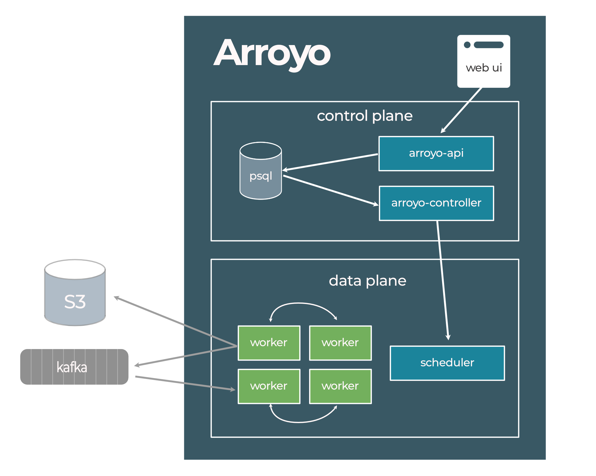
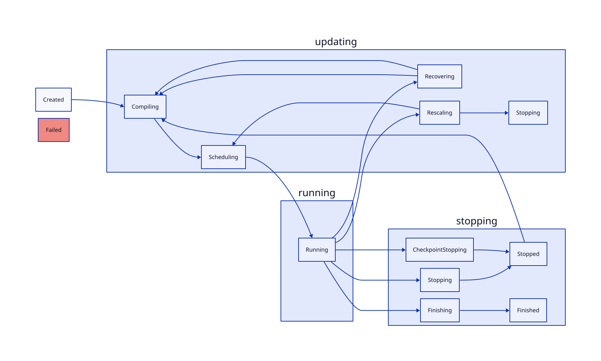

import { Aside } from '@astrojs/starlight/components';

The Arroyo system architecture is composed of several services, as can be seen in the following diagram:

These services can be run in a single process for a simple deployment, or separately for a fully scaleable,
fault-tolerant system.  All components of the system are compiled into a single binary `arroyo`
which provides sub-commands to run specific services or an entire Arroyo cluster.

This document will cover the subsystems that make up an Arroyo cluster.

## Web UI

The Web UI is a web app that interacts with the system via the [REST API](/api).
It allows users to configure the system, create pipelines, and monitor their statuses.

## Arroyo API

The API server backs the Web UI and handles all configuration operations and pipeline management via the [REST API](/api).

API operations, like creating a pipeline or updating its state, operate solely by updating the configuration in
the backing database. This is asynchronously applied to the actual state of the environment by the controller. The API
itself is stateless and does not communicate with the rest of the system except via the database.

## Arroyo Controller

The controller runs a control loop that continuously reconciles the desired state of the system (as defined in the database)
with the actual state of the system, as determined by monitoring the environment. This is similar to a Kubernetes
controller, (see [here](https://kubernetes.io/docs/concepts/architecture/controller/) for an overview of this pattern).

There is a single controller instance that runs in the system, and high-availability is not yet supported in the open
source release. In the default [controller mode](#controller-mode), if the controller instance fails, the workers will
eventually stop and wait for the controller to come back online. In [worker mode](#worker-mode) (beta), running
pipelines can continue without the controller.

The controller manages a state machine for each job, which is documented [here](#job-state-machine). In controller mode,
it is also responsible for initiating checkpoints on the workers. Communication between the controller and workers is
done via the gRPC API defined in [rpc.proto](https://github.com/ArroyoSystems/arroyo/blob/master/crates/arroyo-rpc/proto/rpc.proto).

## Schedulers

Arroyo supports multiple schedulers, which are responsible for running the workers that make up the dataflow engine.
The scheduler can be set by setting the `controller.scheduler` [config key](/configuration#controller).

### Process Scheduler

The process scheduler is the default scheduler. It spawns workers locally as independent processes.

### Node Scheduler

Arroyo comes with a lightweight scheduler and node runtime for running distributed workers. In this mode, you must start
some number of `arroyo node` processes (for example, in an autoscaling group) and configure them with the controller's
address. The controller will then schedule workers on these nodes.

### Kubernetes Scheduler

Arroyo can be deployed to [Kubernetes](https://kubernetes.io/) and configured to schedule workers on the cluster.
See more details [here](/deployment/kubernetes).

### Embedded Scheduler

The embedded scheduler runs pipelines within the same process as the controller. This is most useful for development
on Arroyo itself and is not recommended for production use.

## Arroyo Worker

Workers run the actual processing logic, making up the dataplane. Workers run a binary that is produced by linking
Rust code generated from the SQL query with the arroyo-worker library. Workers within the same pipeline are connected
via TCP connections over which dataflow occurs. Each worker is configured with a number of slots, which controls how
many subtasks it may run. By default, each slot runs a parallel slice of the entire DAG, which generally does a good
job of balancing the load across workers.

The controller is responsible for scheduling the necessary number of workers to run a pipeline, monitoring their health,
and recovering from failures. Checkpoints are coordinated by the pipeline's job controller, which runs either in the
controller or on one of the pipeline's workers; see [Job controller modes](#job-controller-modes).

## Job controller modes

Each running pipeline has a _job controller_ that coordinates its workers. The job controller triggers checkpoints and
tracks their progress, runs the commit phase for transactional sinks, and detects worker and task failures. The
`job-controller` [config option](/configuration) controls where job controllers run.

### Controller mode

In controller mode (`job-controller = "controller"`, the default), the job controllers for all pipelines run inside the
Arroyo controller. Workers send heartbeats and checkpoint progress to the controller, and checkpoint metadata is stored
in the config database.

Because the controller coordinates every checkpoint, pipelines depend on it to make progress. If the controller fails,
workers will eventually stop, and when it comes back, running pipelines are rescheduled and restored from their latest
checkpoints.

### Worker mode

<Aside type="caution" title="Beta">
Worker mode is in beta. It has the known limitations listed below, and its behavior and configuration may change in
future releases.
</Aside>

In worker mode (`job-controller = "worker"`), each pipeline's job controller runs on one of that pipeline's own workers,
called the _leader_. The leader is chosen when the pipeline is scheduled and also runs its share of the pipeline's tasks.
The other workers send heartbeats and checkpoint progress to the leader, and checkpoint metadata is written to the
checkpoint object store instead of the config database.

The Arroyo controller still schedules workers and runs each job's [state machine](#job-state-machine), but it monitors
and controls running pipelines by polling their leaders, every `controller.leader-poll-interval`. If the controller
doesn't get a response from a leader within `pipeline.worker-heartbeat-timeout`, it treats the job as failed and
recovers it from its latest checkpoint.

Worker mode has two main benefits:

* **Pipelines survive controller restarts.** Running pipelines don't depend on the controller. If it restarts, for
  example during an upgrade or after a crash, the pipelines keep running and checkpointing. When it comes back, it
  reconnects to their leaders instead of rescheduling them. This requires workers that outlive the controller process,
  as with the [Kubernetes scheduler](#kubernetes-scheduler). The process scheduler stops its workers when the controller
  exits (unless `process-scheduler.shutdown-with-controller` is disabled), and `arroyo node` processes shut down along
  with their workers when they lose contact with the controller.
* **Less load on the controller and database.** Checkpoint coordination is spread across each pipeline's workers, and
  checkpoints don't write to the config database, which helps clusters running many pipelines.

There are also some differences from controller mode to be aware of:

* **Checkpoint history.** The checkpoint details shown in the Web UI and returned by the checkpoints API are served by
  the leader, which keeps details for the most recent `worker.checkpoint-details-to-keep` checkpoints. They're only
  available while the pipeline is running, and the API service must be able to reach the workers' RPC addresses.
* **Restarting without state.** A pipeline must be stopped or failed before it can be restarted without state. The
  restart replaces the pipeline's job with a new one that has a new job ID.
* **No checkpoint compaction.** The `pipeline.compaction` options aren't supported in worker mode yet.
* **No state migration between modes.** The two modes record checkpoints differently, so a pipeline won't restore from
  checkpoints taken in the other mode. Choose the mode when setting up a cluster. If you switch an existing cluster,
  its pipelines will lose the state from checkpoints taken in the previous mode.

See the [configuration reference](/configuration) for the options that tune worker mode.

## Config Database

The Arroyo control plane relies on a configuration database to store the registered tables and pipelines and to
power the API and Web UI. Two databases are supported, with different scalability and reliability tradeoffs:

* Postgres is the recommended choice for high-scale and distributed clusters
* Sqlite is recommend when running locally and for pipeline clusters

## Object stores

Arroyo relies on remote storage to store checkpoints so that pipelines can be recovered in case of failure or
if they need to be rescaled or rescheduled. Local directories and remote object stores are supported;
the former typically just for development and testing, while production use cases will use the latter. S3 (Amazon), GCS (Google Cloud),
and ABS (Azure) are supported, as are alternative S3-compatible stores like Minio, Cloudflare R2, and
Backblaze B2.

## Job State Machine

Jobs are managed via a state machine that is implemented in the controller:

Jobs are initialized in the `Created` state when they are created via the API. Once the controller loads the job, it
will begin managing it, and is responsible for moving it to a terminal state (like Running, Stopped, Failed) within a
bounded amount of time.
